  

  

I build AI products that go past the demo stage — FastAPI backends, LLM integrations and clean interfaces that people can actually rely on. Right now I'm focused on LLM applications, AI agents and system design.

  

### Tech

  

### Selected work

  
  
  

  

